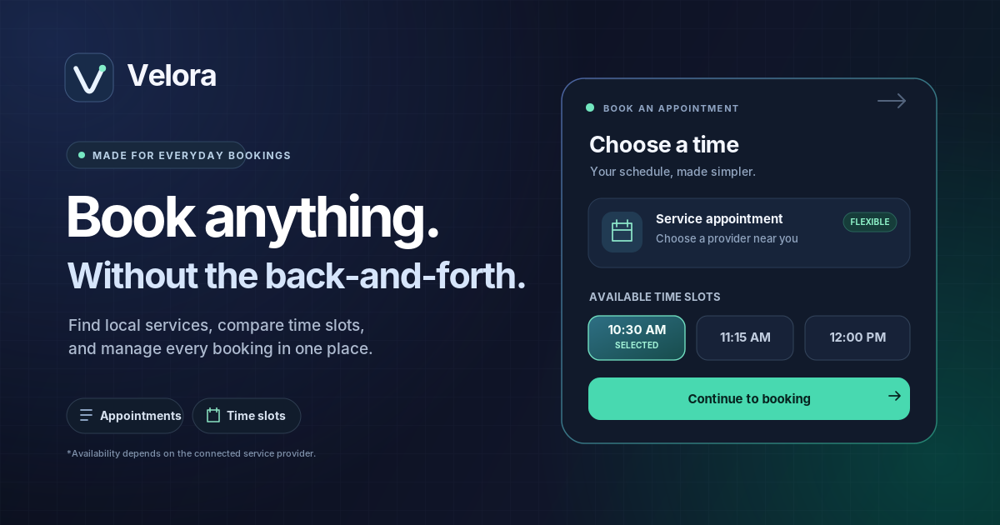
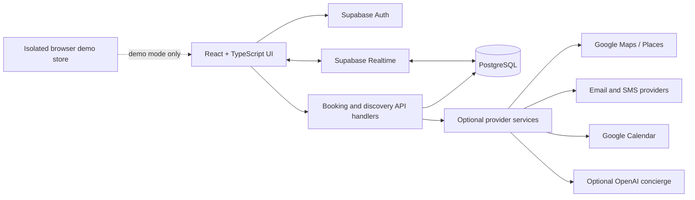

<div align="center">
  

  # Velora
  **An India-first appointment and local-service booking platform.**

  Discover a service, compare appointment times, book confidently, and give businesses one place to manage their day.

  <p>
    <a href="https://velora-ai-in.netlify.app/">Demo deployment</a> ·
    <a href="DEPLOY.md">Deployment guide</a> ·
    <a href="ENGINEERING_NOTES.md">Engineering notes</a> ·
    <a href="HACKATHON_DEMO.md">Hackathon demo guide</a>
  </p>

  
  
  
  
  [](https://github.com/Amit-yadav12/Velora_12/actions/workflows/ci.yml)

  <sub>Maintained by <a href="https://github.com/Amit-yadav12">Amit Yadav</a> · Product prototype and hackathon project</sub>
</div>

---

## What it does

Velora brings customer booking and day-to-day business operations into one product. It is designed for Indian local services—from clinics and salons to sports facilities and professional appointments—with rupee pricing, Indian phone numbers, and Asia/Kolkata-aware scheduling.

### Customer experience

- Browse and search local services, with Google Places discovery available when a Maps key is configured.
- Compare service, staff, date, and available time slots; compare a transparent service-fit score and a scheduling-heuristic recommendation with optional AI concierge enrichment.
- Create and manage bookings, view booking history, and receive a verifiable QR ticket plus downloadable confirmation.
- Open directions and add an appointment to Google Calendar; server-side Google Calendar event creation is optional and credential-dependent.
- Sign in with email/password, Google OAuth through Supabase, or SMS one-time code when the matching provider is configured.

### Business console

- Manage business profiles, services, staff, appointments, and customer records.
- Track day-to-day activity with metrics derived from the app's booking records.
- Use Supabase Realtime subscriptions for supported database updates; demo mode uses a local shared data store for an offline walkthrough.
- Verify signed booking tickets and review operational/audit records.

### Product and engineering details

- Responsive React UI with route-level code splitting, transitions, accessible loading/error states, and a progressive web app shell.
- React + TypeScript frontend, Vite build, Supabase Auth/PostgreSQL/Realtime, API handlers, and Netlify/Vercel deployment support.
- Capacity-aware booking checks, server-side validation, rate limiting, idempotency support, and HMAC-signed QR payloads.
- Email delivery through configured providers (Resend, SendGrid, or relay); no provider is reported as successful when it is not configured.
- A deterministic service-fit score shows its rating, distance and reported opening-hours signals; an actual free slot is checked separately during booking. Slot recommendations disclose that wait/crowd values are estimates, not live telemetry.
- Optional AI concierge enrichment is kept separate from core ranking so recommendations remain explainable and usable without paid model credentials.

> **Demo vs production:** local demo mode is useful without credentials, but it is not a production identity provider or shared cloud database. Google sign-in, SMS OTP, persistent database writes, live Google Places, external email delivery, and real Calendar event creation require provider configuration and end-to-end testing. Public demo account provisioning is disabled by default when Supabase is configured. Enable it only on a separate demo deployment with sample data—never on an environment containing real customer or business records.

## Stack

| Layer | Technology |
| --- | --- |
| UI | React 19, TypeScript, Tailwind CSS 4, Framer Motion, Lucide |
| Build and routing | Vite 7, React Router |
| Authentication and data | Supabase Auth, PostgreSQL, Row Level Security, Realtime |
| Server/API | Node-compatible API handlers, Vercel routes, Netlify adapter |
| Maps and calendar | Google Maps/Places, Google Calendar API (optional) |
| Notifications | Supabase in-app notifications, optional Resend/SendGrid/SMTP relay |
| Testing | TypeScript, ESLint, integration harnesses, jsdom-based application and API checks |

## Architecture



The production path uses provider-backed auth and database access. The browser demo store is a separate fallback for evaluation and should not be described as a shared production database. API endpoints validate booking actions server-side; database access rules are defined in the Supabase migrations.

## AI boundary

Velora keeps the core decision path understandable:

- **Service-fit score:** a deterministic heuristic using the signals available for a listing. Missing distance or availability information is not invented.
- **Slot suggestions:** rule-based scheduling guidance. Waiting-time and crowd values are estimates unless a configured, measured source supplies them.
- **AI concierge:** optional language-model enrichment when `OPENAI_API_KEY` is configured. It is not required for core booking validation and does not turn the ranker into a trained predictive model.

This distinction is intentional: the demo should make it easy to inspect why a recommendation was made and which inputs are real, estimated, or missing.

## Run locally

**Requirements:** Node.js 22.22.2+, 24.15+, or 26+, npm, and Git. CI and Netlify use the Node.js version pinned in `.nvmrc`.

```bash
git clone https://github.com/Amit-yadav12/Velora_12.git
cd Velora_12
npm ci
cp .env.example .env
npm run dev
```

The frontend and development API middleware start through Vite at `http://localhost:5173`. The environment template intentionally leaves public-origin values blank so a local development URL cannot accidentally be stamped into a production build. If your remote preview requires a non-local hostname, add only that trusted hostname to `VITE_DEV_ALLOWED_HOSTS`; Vite host validation remains enabled by default. With the Supabase values left blank, Velora uses local demo data and demo authentication. For cloud authentication and persistence, set `VITE_SUPABASE_URL` and `VITE_SUPABASE_ANON_KEY` in `.env`, then follow the setup guide. Server API persistence additionally requires `SUPABASE_URL` and `SUPABASE_SERVICE_ROLE_KEY` in the server environment.

### Configuration at a glance

| Capability | Configuration |
| --- | --- |
| Frontend Supabase Auth and Realtime | `VITE_SUPABASE_URL`, `VITE_SUPABASE_ANON_KEY`, schema migrations, RLS |
| Server API database access | `SUPABASE_URL`, `SUPABASE_SERVICE_ROLE_KEY` (server only) |
| Google sign-in | Enable Google under Supabase Auth → Providers; configure Google OAuth callback and app redirect URLs |
| Phone OTP | Enable phone auth and configure a supported SMS provider in Supabase Auth |
| Google Maps / Places | `VITE_GOOGLE_MAPS_API_KEY` (server-side `GOOGLE_MAPS_API_KEY` for API calls) |
| Signed booking QR | `QR_SIGNING_SECRET` on the server in production |
| Confirmation email | One of `RESEND_API_KEY`, `SENDGRID_API_KEY`, or `SMTP_RELAY_URL` |
| Google Calendar event sync | `GOOGLE_CALENDAR_ID`, `GOOGLE_CALENDAR_REFRESH_TOKEN`, `GOOGLE_CLIENT_ID`, `GOOGLE_CLIENT_SECRET` |
| AI concierge enrichment | `OPENAI_API_KEY`; the rule-based fallback works without it |
| Scheduled reminders | `CRON_SECRET` and the host's scheduled-function configuration |
| Public demo accounts | Set both `VITE_ENABLE_PUBLIC_DEMO_ACCOUNTS=true` and `ENABLE_PUBLIC_DEMO_ACCOUNTS=true` only on an isolated demo deployment |

Never put service-role keys, Google client secrets, refresh tokens, signing secrets, or mail-provider keys in variables prefixed with `VITE_`. Only the Supabase publishable/anon key belongs in the browser.

## Database setup

For a fresh Supabase project:

1. Open **SQL Editor** in the Supabase dashboard.
2. Run the full [`supabase/APPLY_ALL.sql`](supabase/APPLY_ALL.sql) file. It bundles the ordered core schema, role-lock migration, and RLS tightening migration.
3. Verify that the expected tables exist and that the Realtime publication includes the configured tables (`bookings`, `notifications`, `reminders`, `businesses`, and `booking_history`).
4. Configure Supabase Auth URL settings and providers as described in [`DEPLOY.md`](DEPLOY.md).
5. Business access is assigned by the server-side business registration flow or a trusted operator using [`supabase/PROMOTE_ADMIN.sql`](supabase/PROMOTE_ADMIN.sql). Never accept a role from browser-controlled input.

Do not run only the core migration on a new production project: the later role-lock and RLS-tightening migrations are important security controls.

## Commands

```bash
npm run dev                 # Local app + development API middleware
npm run lint                # ESLint
npm run build               # TypeScript project build + Vite production build
npm run preview             # Preview the generated production build
npm run sql:check           # Ensure APPLY_ALL.sql matches ordered migrations
npm run verify:assets       # Icon dimensions, manifest, social and sitemap metadata
npm run verify:site-origin  # Site-origin stamping for sitemap and robots
npm run verify:recommendations # Scoring logic and explanation regression checks
npm run verify:timezone        # Asia/Kolkata slot and date regression checks
npm run verify:demo         # Demo data and demo auth checks
npm run verify:integrations # Calendar, email, QR, booking guard integration checks
npm run verify:app          # Mount app in jsdom and exercise core customer/business flows
npm run verify              # Run security, asset, recommendation, timezone, SQL, demo, integration, app and site-origin checks
```

The integration suite uses mocked external providers where appropriate. A green local test suite does **not** prove that OAuth consent, SMS delivery, real email delivery, live Maps results, or production hosting credentials are configured; verify these with a real test account after deployment. For a judge-facing walkthrough, use the honest demo sequence in [`HACKATHON_DEMO.md`](HACKATHON_DEMO.md); it distinguishes local demo state from live cloud integrations.

Before sharing this repository with judges, run the build and verification commands on a supported Node.js version, confirm the [GitHub Actions workflow](https://github.com/Amit-yadav12/Velora_12/actions) is green for the submitted commit, and personally test the hosted demo URL. The marketing preview image is an illustration, not a captured screenshot of the running application.

## Project layout

```text
api/                  Serverless API handlers and server-side utilities
shared/               Small timezone helpers shared across browser and API code
src/lib/sampleData.js   Shared labels for local sample listings and provider data
netlify/               Netlify function adapter and scheduled jobs
src/app/               Authenticated route guards and app shells
src/components/        Shared UI and booking components
src/contexts/           Auth and location state
src/lib/                Supabase client, demo data, auth, maps, calendar and helpers
src/pages/customer/     Discovery, booking, profile and customer history
src/pages/admin/        Business console and operational views
src/services/           Booking actions, events and verification
supabase/migrations/    Ordered, versioned database migrations
supabase/APPLY_ALL.sql  Generated one-paste database bootstrap
scripts/                Build and verification scripts
.github/workflows/      Continuous integration
```

## Deployment

Use [`DEPLOY.md`](DEPLOY.md) for Supabase, OAuth, phone OTP, environment variables, security migrations, Netlify/Vercel setup, and post-deploy checks. [`ENGINEERING_NOTES.md`](ENGINEERING_NOTES.md) documents component boundaries and release checks. Production readiness depends on provider setup and applying the database migrations; source code alone cannot provision external accounts or secrets.

The production build also stamps `dist/sitemap.xml` and `dist/robots.txt` from `APP_URL` (or `VITE_APP_URL`), so deploy previews and custom domains can keep their public SEO URLs aligned. Set the origin in your hosting environment before building a release.

## Publishing for a hackathon

1. Extract the source archive and upload the files inside its root to the root of your GitHub repository. Do not upload `node_modules`, `.env`, or a nested copy of the entire project folder.
2. Wait for the CI workflow to finish on the commit you intend to submit. Fix any red check before sharing the repository.
3. Configure the actual demo deployment and confirm sign-in, booking persistence, ticket verification, and the business view in a fresh browser session. If the demo is local-only or provider services are not configured, label that clearly in the presentation.
4. Share the repository URL and a working demo/video URL in the submission form.

## Security notes

- Copy `.env.example` to `.env`; the template contains no usable credentials.
- Keep `.env` out of Git. `.gitignore` excludes it and `*.local` files.
- Expose only publishable Supabase values to the client; keep service credentials on the server.
- Apply `0003_rls_tightening.sql` through `APPLY_ALL.sql` before production use.
- Use a unique cryptographically random `QR_SIGNING_SECRET` and a strong `CRON_SECRET` in production.
- Keep admin role assignment server-controlled. A hidden button or a client-side role field is not an authorization boundary.
- See [`SECURITY.md`](SECURITY.md) for responsible disclosure guidance.

## Contributing

Small, reviewable changes are preferred. Before opening a PR, run `npm run lint`, `npm run build`, `npm run sql:check`, and `npm run verify`. Never commit real customer data, credentials, generated `dist/`, or `node_modules/`. See [`CONTRIBUTING.md`](CONTRIBUTING.md).
